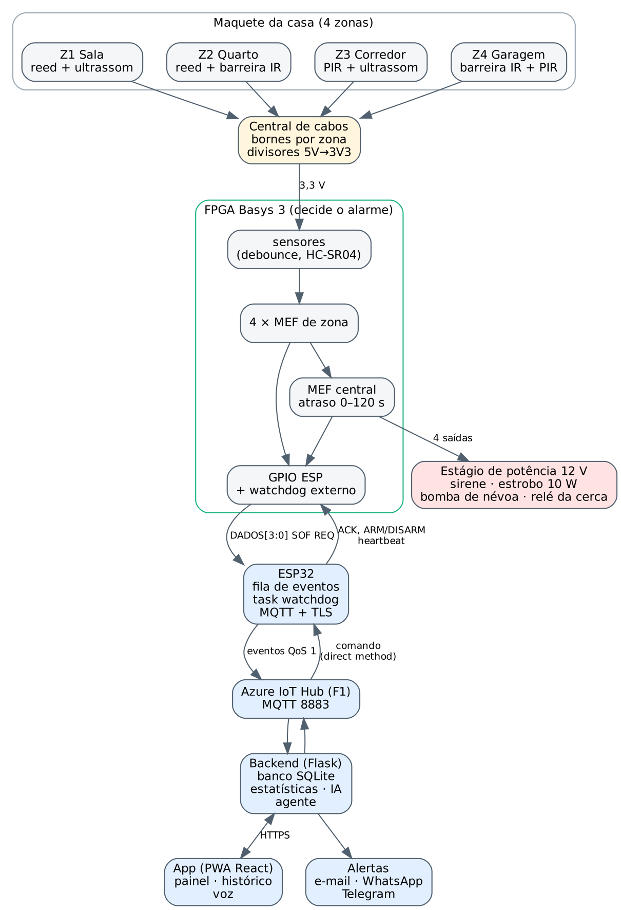

# 1. Introdução

## 1.1 Objetivo

O projeto é uma central de alarme residencial perimétrica com quatro zonas, feita para a disciplina de Sistemas Embarcados. A central fica dentro de um FPGA (placa Basys 3) e precisa fazer três coisas: detectar a invasão, agir (sirene e contramedidas) e explicar o próprio estado, inclusive quando um sensor falha.

O ponto difícil do enunciado é que uma invasão e uma falha de sensor geram sinais parecidos. Por isso cada zona tem dois sensores de tipos diferentes. Qualquer um dos dois dispara o alarme na hora. Se o segundo não confirmar dentro de um tempo (Tcorr), a zona continua em alarme, mas passa a avisar que a cobertura está degradada.

## 1.2 Requisitos que guiaram o projeto

Tiramos os requisitos dos slides do professor e numeramos para poder citar nos testes.

| Nº | Requisito | Onde é atendido |
|---|---|---|
| R1 | Quatro zonas, cada uma com dois sensores e uma MEF | `mef_zona.vhd` (4 cópias) |
| R2 | Qualquer evidência válida liga o alarme da zona na hora | estados CONFIRMA, AL_NORMAL e AL_DEG |
| R3 | Sem confirmação até Tcorr a zona entra em modo degradado | contador `t` em ciclos de clock |
| R4 | Falha diagnosticada (F = 1) degrada sem esperar | transições com F = 1 |
| R5 | AL retido até o desarme; DEG retido até reconhecimento e teste | sinal `deg_ret` |
| R6 | Zona isolável e removível, com injeção de falhas por zona | chaves SW3..0 e SW10..4 |
| R7 | MEF central com atraso configurável de 0 a 120 s | `mef_central.vhd`, chaves SW13..11 |
| R8 | Sirene e pelo menos duas contramedidas com carga real | estrobo de 10 W e névoa de água |
| R9 | Display mostrando A, d e U | `display.vhd` |
| R10 | Integração no IP Integrator com IPs da Xilinx e próprios | `scripts/cria_projeto.tcl` |
| R11 | Interface FPGA–ESP32 por GPIO com confirmação | `gpio_esp.vhd` e `cmd_esp.vhd` |
| R12 | Watchdog interno na ESP32 e supervisão externa pelo FPGA | task watchdog + `wdt_esp.vhd` |
| R13 | MQTT com TLS e autenticação, QoS 1, fila local | firmware da ESP32 |
| R14 | Comando remoto com cmd_id, validade e resposta do FPGA | backend + firmware + `cmd_esp.vhd` |
| R15 | Histórico com event_id e incident_id, sem duplicar | banco do backend |
| R16 | Alerta ao usuário dizendo quais zonas foram violadas, por mais de um canal | e-mail + WhatsApp + Telegram |
| R17 | Painel em PC e celular, mostrando dado recente e dado antigo | app PWA em React |
| R18 | Agente com estatísticas e voz; arme e desarme com confirmação | backend + app |
| R19 | Redução de falso-positivo | filtros no FPGA + nota no backend |
| R20 | A central continua decidindo sem Wi-Fi, nuvem ou agente | toda a decisão fica no FPGA |

## 1.3 Visão geral

{width=11cm}

Cada parte tem uma responsabilidade e um limite de confiança, como pede o slide 3:

- **FPGA**: é quem decide. As MEFs rodam em paralelo e os tempos são contados em ciclos de clock, então a resposta local tem prazo conhecido. Não depende de mais nada.
- **ESP32**: só transporta. Lê o estado do FPGA, guarda os eventos e manda para a nuvem. Como é software, pode travar, então tem watchdog interno e o FPGA ainda vigia por fora.
- **MQTT e nuvem (Azure IoT Hub)**: levam eventos e comandos, guardam o histórico e alimentam o painel. A rede atrasa e cai, então tudo tem confirmação e o painel mostra quando o dado está velho.
- **Agente (LLM)**: conversa e explica. Pode entender errado, então não calcula nada e não comanda a central sozinho: os números vêm do backend e o desarme sempre pede o PIN.

## 1.4 Pares de sensores

Usamos os pares sugeridos no slide 6:

| Zona | Local na maquete | Sensor A (R) | Sensor B (U) |
|---|---|---|---|
| Z1 | Sala | Reed na porta | Ultrassônico HC-SR04 |
| Z2 | Quarto | Reed na janela | Barreira IR |
| Z3 | Corredor | PIR HC-SR501 | Ultrassônico HC-SR04 |
| Z4 | Garagem | Barreira IR | PIR HC-SR501 |

No VHDL os dois sensores de cada zona se chamam sempre R e U, como nas tabelas do enunciado. Trocar o par de uma zona muda só o bloco `sensores.vhd` e o arquivo de pinos; a MEF da zona não muda.

## 1.5 Decisões de projeto

1. **Clock de 10 MHz**. O Clocking Wizard baixa os 100 MHz da placa para 10 MHz. Para alarme é mais que suficiente (resolução de 100 ns) e deixa muita folga de timing.
2. **Tempos em ciclos de clock**. Tcorr e o atraso da central são contadores do próprio clock, sem depender de software.
3. **Entradas sempre sincronizadas**. Todo sinal externo passa por dois flip-flops e por um filtro de persistência antes de chegar em uma MEF.
4. **Barramento de 4 bits com REQ/ACK para a ESP32**. Preferimos isso a uma serial porque o enunciado pede GPIO com confirmação, e o handshake deixa o FPGA perceber quando a ESP parou de responder.
5. **Comando remoto por direct method do IoT Hub**. A chamada só retorna quando a ESP32 responde, e a ESP32 só responde depois do CMD_ACK do FPGA. Assim o painel mostra o resultado real e não o que ele acha que aconteceu.
6. **Cerca elétrica só com interface isolada**. Seguimos o slide 23: o FPGA aciona um relé isolado que habilita um energizador comercial. Não montamos circuito de alta tensão.
7. **Custo zero de nuvem**. IoT Hub no plano gratuito F1, banco SQLite em arquivo, alertas por serviços gratuitos e modelo de linguagem local (Ollama).
