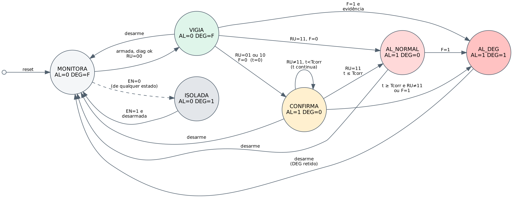
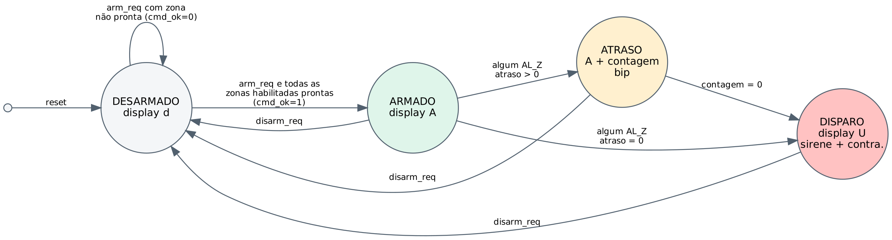

# 2. Máquinas de estados

## 2.1 MEF da zona

São quatro cópias do mesmo bloco (`fpga/src/mef_zona.vhd`). As entradas R, U e F já chegam qualificadas (sincronizadas e filtradas).

{width=16cm}

### Estados e saídas

| Código | Estado | AL | DEG | Significado |
|---|---|---|---|---|
| 0 | ISOLADA | 0 | 1 | Zona desabilitada pela chave (EN = 0). Aparece no painel como isolada |
| 1 | MONITORA | 0 | F ou DEG retido | Central desarmada. Faz o diagnóstico de 0,5 s |
| 2 | VIGIA | 0 | F ou DEG retido | Armada e em repouso |
| 3 | CONFIRMA | 1 | 0 | Um sensor atuou. Conta Tcorr esperando o outro |
| 4 | AL_NORMAL | 1 | 0 | Os dois sensores confirmaram no prazo |
| 5 | AL_DEG | 1 | 1 | Não confirmou até Tcorr, ou havia falha |

### Tabela de transições

| Estado atual | Condição | Próximo estado | Ação |
|---|---|---|---|
| Qualquer | EN = 0 | ISOLADA | AL = 0, DEG = 1, zera diagnóstico |
| ISOLADA | EN = 1 e central desarmada | MONITORA | Reinicia o diagnóstico |
| MONITORA | Central desarmada | MONITORA | Conta o diagnóstico; trata a recuperação do DEG |
| MONITORA | Armada, diagnóstico concluído e RU = 00 | VIGIA | Limpa as evidências |
| VIGIA | RU = 00 | VIGIA | DEG = F |
| VIGIA | RU = 01 ou 10, F = 0 | CONFIRMA | AL = 1, t = 0 |
| VIGIA | RU = 11, F = 0 | AL_NORMAL | AL = 1 |
| VIGIA | (R ou U) e F = 1 | AL_DEG | AL = 1, DEG = 1, motivo = falha |
| CONFIRMA | F = 1 | AL_DEG | motivo = falha, sem esperar |
| CONFIRMA | RU = 11 e t ≤ Tcorr | AL_NORMAL | Para a contagem |
| CONFIRMA | RU ≠ 11 e t ≥ Tcorr | AL_DEG | DEG = 1, motivo = sem confirmação |
| CONFIRMA | RU ≠ 11 e t < Tcorr | CONFIRMA | t = t + 1 |
| AL_NORMAL | F = 1 | AL_DEG | motivo = falha |
| VIGIA, CONFIRMA, AL_NORMAL, AL_DEG | Desarme | MONITORA | AL = 0. O DEG retido continua |

Detalhes que o enunciado pede e que estão no código:

- **Prioridade no limite**. Em CONFIRMA o teste de RU = 11 vem antes do teste do tempo, então se a confirmação chega exatamente em t = Tcorr o resultado é AL_NORMAL.
- **O contador não reinicia**. Trocar 01 por 10 ou voltar para 00 mantém o estado CONFIRMA e o `t` continua contando.
- **AL retido**. Depois que a zona dispara, só o desarme tira o AL, mesmo que os sensores voltem ao repouso.
- **DEG retido**. O sinal `deg_ret` só é limpo com a central desarmada, depois de um reconhecimento (botão BTNL) e de um teste válido: os dois sensores precisam atuar e voltar ao repouso, com F = 0. O reconhecimento é só local de propósito, porque alguém precisa estar na frente do sensor para fazer o teste.
- **Motivo do DEG**. A saída `motivo` informa a causa (01 sem confirmação, 10 falha, 11 isolada) e vai para o painel.
- **Arme só com a zona pronta**. A saída `pronta` só vale 1 com diagnóstico concluído e RU = 00. Se uma porta está aberta, a central recusa o arme.

### Temporização

| Tempo | Valor | Em ciclos (10 MHz) | Como ajustar |
|---|---|---|---|
| Tcorr | 0,1 s / 0,5 s / 1 s / 2 s | 1 000 000 / 5 000 000 / 10 000 000 / 20 000 000 | Chaves SW15..14 |
| Diagnóstico | 0,5 s | 5 000 000 | Constante `T_DIAG` |
| Debounce do reed | 20 ms | 200 000 | `N_REED` em `sensores.vhd` |
| Filtro da barreira IR | 10 ms | 100 000 | `N_IR` |
| Filtro do PIR | 50 ms | 500 000 | `N_PIR` |
| Ultrassônico | 1 medida a cada 60 ms, 3 seguidas fora da faixa | — | genéricos de `ultrassom.vhd` |

Uma observação importante que apareceu no projeto: o ultrassônico precisa de três medidas seguidas (180 ms) para afirmar que a distância mudou. Com Tcorr = 0,1 s, que é o valor de exemplo do slide, uma zona com ultrassônico nunca confirmaria a tempo e toda entrada viraria alarme degradado. Por isso o Tcorr é ajustável nas chaves e, nas zonas 1 e 3, usamos 1 s ou 2 s. O valor de 0,1 s continua disponível e é o usado nos testbenches.

### Diagnóstico de falha (F)

| Origem do F | Como é detectado |
|---|---|
| Ultrassônico sem eco | 5 períodos seguidos sem eco válido (sensor desligado, cabo solto) |
| Falha injetada | Chave SW10 com a zona selecionada em SW7..4 |
| Reed ou fio rompido | A entrada tem pull-up: fio solto parece porta aberta, dispara o alarme e, sem confirmação, vira DEG |
| Sensor preso em ativo | A zona não fica pronta e o arme é recusado |

### Injeção de falhas

Com uma zona selecionada em SW7..4 o painel mostra TESTE, e as leituras reais daquela zona são trocadas pelas chaves:

| Ensaio | Chaves | Resultado esperado |
|---|---|---|
| Somente sensor A | SW8 = 1, SW9 = 0 | AL imediato, DEG só depois de Tcorr |
| Somente sensor B | SW8 = 0, SW9 = 1 | AL imediato, DEG só depois de Tcorr |
| Confirmação | SW8 e depois SW9, antes e depois de Tcorr | No prazo DEG = 0; depois, DEG retido |
| Sensor travado | SW10 = 1 e SW8 = 1 | Alarme pela evidência e DEG por falha, sem espera |
| Falha de conexão | Tirar o conector da zona | DEG com motivo; alarme se houver evidência |

Para o ensaio de confirmação com as chaves usamos Tcorr = 2 s, porque ninguém consegue mexer em duas chaves em 0,1 s. O limite exato (antes, no limite e depois) é conferido ciclo a ciclo no testbench.

## 2.2 MEF central

{width=15cm}

| Código | Estado | Display | Saídas |
|---|---|---|---|
| 00 | DESARMADO | d | tudo desligado |
| 01 | ARMADO | A | zonas armadas |
| 10 | ATRASO | A + contagem | bip intermitente na sirene |
| 11 | DISPARO | U | sirene, estrobo, cerca e névoa (névoa por 10 s) |

| Estado atual | Condição | Próximo | Resposta ao pedido |
|---|---|---|---|
| Qualquer | disarm_req | DESARMADO | cmd_ok = 1 |
| DESARMADO | arm_req, alguma zona habilitada e todas as habilitadas prontas | ARMADO | cmd_ok = 1 |
| DESARMADO | arm_req e alguma zona habilitada não pronta | DESARMADO | cmd_ok = 0 (recusado) |
| ARMADO | algum AL_Z e atraso = 0 | DISPARO | — |
| ARMADO | algum AL_Z e atraso > 0 | ATRASO | carrega a contagem |
| ATRASO | contagem chegou a zero | DISPARO | — |

**Prioridades**, da maior para a menor: reset, desarme, arme, alarme de zona. Se um desarme e um alarme chegam no mesmo ciclo, vale o desarme.

**Atraso**. SW13..11 escolhem 0, 5, 10, 20, 30, 60, 90 ou 120 s. A contagem é feita em ciclos de clock (N segundos são exatamente N × 10 000 000 ciclos) e é mostrada no display em BCD.

**Latência com atraso zero**. Da entrada qualificada até a sirene são 2 ciclos de clock (200 ns): um para a MEF da zona ir para CONFIRMA e outro para a central ir para DISPARO. O tempo total visto de fora é esse valor mais o filtro do sensor (10 a 50 ms nos sensores digitais).

**Duas zonas no mesmo ciclo**. A central usa o OU dos quatro AL_Z, então não importa quantas zonas disparam juntas: a transição é uma só e cada zona registra o seu incidente.

**Névoa limitada**. A bomba liga por no máximo 10 s em cada disparo, para não encharcar a maquete. A sirene e o estrobo ficam ligados até o desarme.
