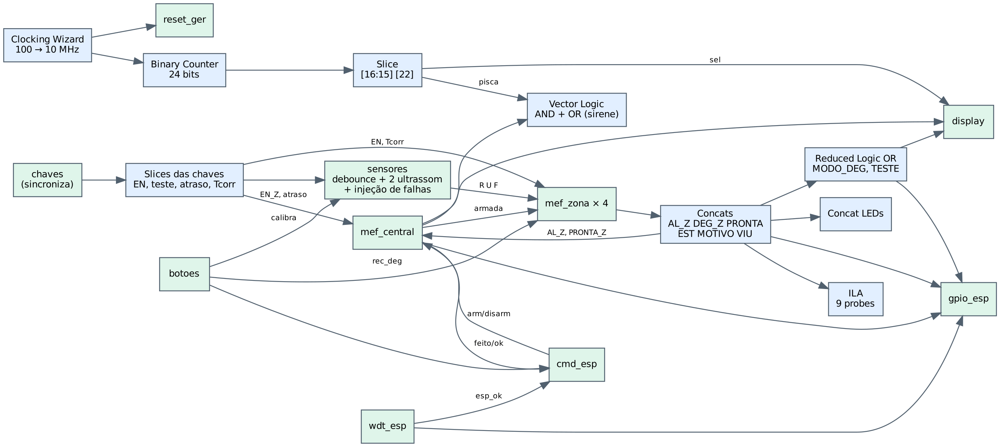

# 3. Projeto no FPGA

## 3.1 Blocos e Block Design

A integração é feita no IP Integrator do Vivado. O script `fpga/scripts/cria_projeto.tcl` cria o projeto, monta o diagrama, liga tudo e gera o wrapper.

{width=16cm}

| IP da Xilinx | Para que usamos |
|---|---|
| Clocking Wizard | Gera os 10 MHz do sistema a partir dos 100 MHz da placa |
| Binary Counter (24 bits) | Base de tempo para a varredura do display e para o pisca |
| Slice | Separa os bits do contador e os campos das 16 chaves |
| Concat | Junta as saídas das 4 MEFs de zona em vetores (AL_Z, DEG_Z, estados) e monta os LEDs |
| Utility Reduced Logic | MODO_DEGRADADO = OU dos DEG_Z; TESTE = OU das chaves de teste |
| Utility Vector Logic | Sirene = disparo OU (pré-alarme E pisca) |
| ILA | Depuração: AL_Z, DEG_Z, estados, R/U/F da zona 1 e distância medida |

| IP próprio (VHDL) | Função |
|---|---|
| `mef_zona` (×4) | MEF de cada zona |
| `mef_central` | MEF da central, atraso e contramedidas |
| `sensores` | Sincroniza e filtra os sensores, lê os dois HC-SR04, injeta falhas |
| `ultrassom` | Dispara o TRIG, mede o ECHO e compara com a referência d0 |
| `sinc_debounce` | Dois flip-flops e filtro de persistência |
| `chaves`, `botoes` | Sincronizam as chaves e geram um pulso por aperto de botão |
| `cmd_esp` | Handshake de comando com a ESP32 e junção com os botões |
| `gpio_esp` | Envia o estado para a ESP32 em quadros de 13 nibbles |
| `wdt_esp` | Watchdog externo da ESP32 |
| `display` | Display de 7 segmentos |
| `reset_ger` | Reset síncrono, liberado só depois do clock travar |

Também deixamos um topo escrito só em VHDL (`top_central.vhd`), que faz as mesmas ligações do diagrama. Ele serve para simular o sistema inteiro no testbench `tb_top` e como plano B para gerar o bitstream.

## 3.2 Painel da placa

| Recurso | Função |
|---|---|
| SW3..0 | Habilita as zonas 1 a 4 (0 = isolada) |
| SW7..4 | Seleciona a(s) zona(s) em TESTE |
| SW8, SW9, SW10 | Força R, força U, injeta falha F na zona em teste |
| SW13..11 | Atraso: 0, 5, 10, 20, 30, 60, 90, 120 s |
| SW15..14 | Tcorr: 0,1 s, 0,5 s, 1 s, 2 s |
| BTNC | Reset geral |
| BTNU / BTND | Armar / desarmar no local |
| BTNL | Reconhecer o modo degradado |
| BTNR | Calibrar a referência d0 dos ultrassônicos |
| LED3..0 | AL das zonas 1 a 4 |
| LED7..4 | DEG das zonas 1 a 4 |
| LED8, LED9 | Central armada, disparo |
| LED10, LED11 | Modo degradado, TESTE |
| LED12, LED13 | ESP32 viva, ESP32 em falha (desistiu de resetar) |
| LED14, LED15 | CMD_ACK, pisca (clock vivo) |
| Display | d, A ou U no dígito da esquerda; contagem do atraso nos outros três; ponto aceso em TESTE |

## 3.3 Pinagem dos conectores Pmod

| Pmod | Pino | Sinal | Direção | Observação |
|---|---|---|---|---|
| JA1 | J1 | z1_reed | entrada | pull-up interno |
| JA2 | L2 | z1_trig | saída | HC-SR04 aceita 3,3 V no TRIG |
| JA3 | J2 | z1_echo | entrada | divisor 1 kΩ / 2 kΩ (5 V para 3,3 V) |
| JA4 | G2 | z2_reed | entrada | pull-up interno |
| JA7 | H1 | z2_ir | entrada | |
| JA8 | K2 | z3_pir | entrada | saída do HC-SR501 já é 3,3 V |
| JA9 | H2 | z3_trig | saída | |
| JA10 | G3 | z3_echo | entrada | divisor 1 kΩ / 2 kΩ |
| JB1 | A14 | z4_ir | entrada | |
| JB2 | A16 | z4_pir | entrada | |
| JB3 | B15 | sirene | saída | para o canal de potência 1 |
| JB4 | B16 | estrobo | saída | habilita o 555 |
| JB7 | A15 | nevoa | saída | canal de potência 3 (bomba) |
| JB8 | A17 | cerca | saída | relé isolado |
| JB9 | C15 | esp_rst | saída | transistor NPN no EN da ESP32 |
| JB10 | C16 | esp_hb | entrada | heartbeat da ESP32 |
| JC1..JC4 | K17, M18, N17, P18 | esp_d[0..3] | saída | dados |
| JC7 | L17 | esp_sof | saída | início de quadro |
| JC8 | M19 | esp_req | saída | |
| JC9 | P17 | esp_ack | entrada | pull-down |
| JC10 | R18 | modo_deg | saída | nível ativo com zona degradada ou isolada |
| JXA1 | J3 | arm_req | entrada | pull-down |
| JXA2 | L3 | disarm_req | entrada | pull-down |
| JXA3 | M2 | cmd_ack | saída | |
| JXA4 | N2 | cmd_ok | saída | |

Os pinos 5 e 11 de cada Pmod são GND e os pinos 6 e 12 são 3,3 V. O arquivo completo é `fpga/constr/basys3_central.xdc`.

## 3.4 Interface com a ESP32

### Estado: quadro de 13 nibbles com REQ/ACK

Sempre que alguma coisa muda, e pelo menos uma vez por segundo, o bloco `gpio_esp` tira uma foto do estado e envia um quadro:

| Nibble | Conteúdo |
|---|---|
| 0 | Número do quadro (SOF = 1 só neste) |
| 1 | Estado da central (2 bits), TESTE, MODO_DEGRADADO |
| 2, 4, 6, 8 | Zonas 1 a 4: DEG e estado (3 bits) |
| 3, 5, 7, 9 | Zonas 1 a 4: motivo (2 bits), sensor B viu, sensor A viu |
| 10 | F das quatro zonas |
| 11 | Resultado do último comando, falha da ESP |
| 12 | XOR dos nibbles 0 a 11 |

Cada nibble usa handshake de quatro fases: o FPGA coloca o dado e sobe REQ, a ESP lê e sobe ACK, o FPGA baixa REQ e a ESP baixa ACK. Se a ESP não responde em 50 ms o quadro é abandonado e repetido inteiro depois. Como os bits "sensor A viu" e "sensor B viu" e o motivo ficam guardados, a ESP não perde informação mesmo que não pegue o estado CONFIRMA, que pode durar só 0,1 s.

### Comandos: ARM_REQ, DISARM_REQ, CMD_ACK e CMD_OK

1. A ESP sobe ARM_REQ (ou DISARM_REQ) e mantém.
2. O FPGA filtra por 20 ms, entrega o pedido à MEF central, coloca o resultado em CMD_OK e sobe CMD_ACK.
3. A ESP lê CMD_OK e baixa o pedido.
4. O FPGA baixa CMD_ACK.

Proteções contra comando indevido: as duas entradas têm pull-down (com a ESP em reset ficam em 0), o pedido precisa ficar estável por 20 ms, só é aceito com o heartbeat chegando, as duas linhas em 1 juntas são ignoradas e é preciso voltar a 0 antes de um novo pedido.

### Watchdog externo

A ESP inverte o pino de heartbeat a cada 500 ms, mas só se as tarefas dela estiverem andando. O bloco `wdt_esp` espera no máximo 5 s por uma borda. Se não vier, dá um pulso de 100 ms no EN da ESP, espera 8 s pelo boot e repete até 3 vezes. Depois disso para de tentar e acende o LED13. Em nenhum desses casos a central para: as MEFs não dependem da ESP.

## 3.5 Timing e uso de recursos

Estes números saem do Vivado depois da implementação (`scripts/gera_bitstream.tcl` copia os relatórios para `docs/relatorios_vivado/`).

| Item | Valor |
|---|---|
| Clock do sistema | 10 MHz (período de 100 ns) |
| WNS (folga de setup) | **[PREENCHER com o valor do Vivado]** |
| WHS (folga de hold) | **[PREENCHER]** |
| LUTs / flip-flops usados | **[PREENCHER]** |
| Block Design validado sem erros | **[PREENCHER: sim/não]** |
