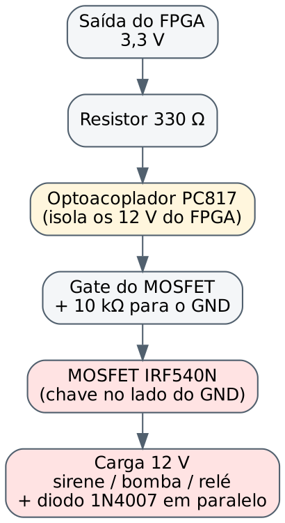

# 4. Hardware, potência e maquete

## 4.1 Sensores e adaptação de nível

Todas as entradas do FPGA e da ESP32 são de 3,3 V.

| Sensor | Alimentação | Saída | Adaptação |
|---|---|---|---|
| Reed + ímã | — | contato para o GND | pull-up interno do FPGA. Porta fechada = 0, aberta = 1 |
| HC-SR04 | 5 V | ECHO de 5 V | divisor: 1 kΩ em série e 2 kΩ para o GND (5 V × 2/3 = 3,3 V). TRIG ligado direto |
| PIR HC-SR501 | 5 V | 3,3 V | ligação direta. Esperar cerca de 1 minuto de estabilização ao ligar |
| Barreira IR (emissor + receptor) | 5 V | digital | se o módulo for alimentado em 5 V, usar o mesmo divisor. Conferir a polaridade e ajustar `IR_ATV` em `sensores.vhd` |

A referência d0 do ultrassônico é capturada na primeira medida válida depois do reset e de novo quando se aperta BTNR com o cômodo vazio. A tolerância é de 290 µs de eco, cerca de 5 cm.

## 4.2 Canal de potência padrão

Os 12 V ficam só no estágio de potência. Usamos o mesmo circuito para as cargas de 12 V:

{width=16cm}

Dimensionamento:

- **LED do optoacoplador**: (3,3 V − 1,2 V) / 330 Ω = 6,4 mA, dentro do que o pino do FPGA fornece.
- **Gate do MOSFET**: o transistor do PC817 leva o gate a quase 12 V. O resistor de 10 kΩ para o GND garante o MOSFET desligado quando o FPGA está desconectado ou sem energia.
- **MOSFET IRF540N**: com 12 V no gate a resistência é de cerca de 44 mΩ. Com 1 A dissipa 1² × 0,044 = 44 mW, sem dissipador.
- **Diodo 1N4007** em paralelo com cargas indutivas (bomba, sirene, bobina de relé), com o catodo no +12 V.
- **Fusível de 3 A** na entrada dos 12 V.

## 4.3 Sirene

Buzzer ativo ou sirene de 12 V no canal 1. No pré-alarme (ATRASO) ela dá bips; no disparo fica contínua.

## 4.4 Estrobo de 10 W

O estrobo usa um 555 em modo astável alimentado em 12 V, como sugere o slide 24, mas com o estágio de saída dimensionado para o LED de 10 W.

**Oscilador**. No astável a frequência é f = 1,44 / ((R1 + 2·R2) · C), onde R1 liga o +12 V ao pino 7, R2 liga o pino 7 aos pinos 6 e 2, e C vai dos pinos 6 e 2 ao GND. Usamos R1 = 10 kΩ, C = 1 µF e R2 formado por 22 kΩ fixos em série com um trimpot de 100 kΩ:

| Trimpot | R2 | Frequência |
|---|---|---|
| 0 Ω | 22 kΩ | 1,44 / (54 kΩ × 1 µF) = 26,7 Hz |
| 46 kΩ | 68 kΩ | 1,44 / (146 kΩ × 1 µF) = 9,9 Hz |
| 100 kΩ | 122 kΩ | 1,44 / (254 kΩ × 1 µF) = 5,7 Hz |

A faixa fica entre 5,7 e 26,7 Hz, dentro do que o enunciado pede (de alguns Hz até 30 ou 40). O ciclo ativo em 10 Hz é (R1 + R2) / (R1 + 2·R2) = 78 / 146 = 53 %.

**Habilitação pelo FPGA**. A saída `estrobo` aciona um PC817. O transistor do opto liga o +12 V ao pino 4 (reset) do 555, que tem um resistor de 10 kΩ para o GND. Com o FPGA em 0, o reset fica em 0 e a saída do 555 fica baixa, então o LED apaga.

**Saída**. O pino 3 do 555 vai por 100 Ω ao gate de um IRF540N. O slide cita o TIP31, mas com 1 A ele precisaria de cerca de 100 mA de base e dissiparia perto de 0,5 W; o MOSFET dissipa 44 mW. O LED COB de 10 W trabalha com cerca de 10,5 V e 0,9 A, então vai em série com R = (12 − 10,5) / 0,9 ≈ 1,7 Ω. Usamos 1,8 Ω de 5 W (dissipa 1,5 W ligado direto e cerca de metade disso piscando).

**Medidas a fazer em bancada**: frequência no pino 3 com o osciloscópio e corrente do LED. A luz fica dentro de uma caixa com difusor, apontada para longe das pessoas, e a frequência é mantida baixa durante a demonstração.

## 4.5 Gerador de névoa

Névoa fria, só com água: reservatório, minibomba de diafragma de 12 V, mangueira de silicone de 4 a 6 mm e bico pulverizador. A bomba vai no canal 3, com o diodo de proteção e um capacitor de 470 µF perto dela por causa da corrente de partida. A parte hidráulica fica do lado oposto às placas e abaixo delas. O FPGA limita cada acionamento a 10 s.

## 4.6 Cerca elétrica

Seguimos o slide 23. O FPGA só comanda a habilitação, por um módulo de relé com optoacoplador. O contato seco do relé iria na entrada de comando de um energizador comercial, se o manual do equipamento tiver essa entrada. Na bancada demonstramos a habilitação e o desligamento com uma carga de baixa tensão (lâmpada de 12 V) e medimos o sinal de controle. Não montamos o circuito de alta tensão: o próprio material do professor diz que o circuito de stun gun não é projeto de energizador, e o taser é de uso exclusivo de forças de segurança.

## 4.7 Reset da ESP32 pelo FPGA

A saída `esp_rst` vai por 10 kΩ à base de um BC547. O coletor vai no pino EN da ESP32 e o emissor no GND. Quando o FPGA põe 1, o transistor puxa o EN para 0 e a ESP reinicia. Com o FPGA desconectado o transistor fica cortado e a ESP funciona normalmente.

## 4.8 Maquete e cabos

- Casa em MDF de 3 mm com quatro cômodos, portas e janela articuladas e os sensores parafusados.
- **Um cabo UTP por zona**, com conector identificado nas duas pontas (Z1 a Z4). Pares: laranja = +5 V e GND, verde = sensor A, azul = sensor B (TRIG e ECHO no ultrassônico), marrom = reserva.
- **Central de cabos**: uma placa com bornes por zona, os divisores de tensão e os canais de potência. É o único lugar onde os sinais são condicionados.
- **Basys 3 removível**: a central de cabos termina em quatro conectores de barra de pinos 2×6 que encaixam nos Pmods JA, JB, JC e JXADC. A placa sai e volta sem soltar nenhum fio.
- Sinal e potência em chicotes separados; cabos presos com abraçadeiras e com alívio de tração.

**Roteiro de desconexão de uma zona**: desarmar, isolar a zona na chave (SW correspondente em 0), desligar a alimentação da zona, tirar o conector. Para voltar: encaixar, religar, subir a chave e esperar o diagnóstico (0,5 s). Se a zona tinha DEG retido, reconhecer com BTNL e fazer o teste dos dois sensores.

## 4.9 Lista de materiais

Os preços dos sensores são os de referência dos slides (07/11/2026). Os demais são estimativas e precisam ser conferidos na compra.

| Item | Qtd. | Preço unit. | Observação |
|---|---|---|---|
| Basys 3 | 1 | — | do laboratório |
| ESP32 DevKit V1 | 1 | ~R$ 35 | |
| Reed + ímã | 2 | R$ 2,00 | preço do slide (sem o ímã) |
| HC-SR04 | 2 | R$ 9,80 | preço do slide |
| PIR HC-SR501 | 2 | R$ 9,90 | preço do slide |
| Barreira IR (emissor + receptor) | 2 | R$ 3,90 | preço do slide é só do emissor |
| LED COB 10 W / 12 V | 1 | ~R$ 15 | |
| NE555, trimpot 100 kΩ, capacitor 1 µF | 1 | ~R$ 5 | |
| MOSFET IRF540N | 4 | ~R$ 5 | |
| Optoacoplador PC817 | 4 | ~R$ 1 | |
| Módulo relé 1 canal com opto | 1 | ~R$ 8 | interface da cerca |
| Minibomba de diafragma 12 V + bico + mangueira | 1 | ~R$ 40 | |
| Buzzer ativo ou sirene 12 V | 1 | ~R$ 10 a 25 | |
| Fonte 12 V 3 A | 1 | ~R$ 30 | |
| Regulador step-down para 5 V (LM2596) | 1 | ~R$ 10 | alimenta sensores e ESP32 |
| Resistores, diodos 1N4007, BC547, bornes, barra de pinos | — | ~R$ 25 | |
| Cabo UTP, MDF, parafusos, abraçadeiras | — | ~R$ 40 | |
