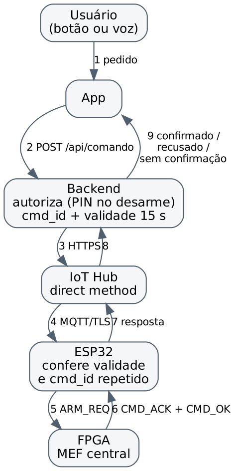

# 5. Firmware da ESP32

O firmware está em `esp32/` (PlatformIO, framework Arduino, versão da plataforma travada no `platformio.ini`). A ESP32 não decide alarme: ela lê, registra, publica e repassa pedidos.

## 5.1 Tarefas

| Tarefa | Núcleo | O que faz |
|---|---|---|
| `tarefaFpga` | 1 | Lê os quadros do FPGA, confere o XOR, compara com o anterior e gera os eventos |
| `tarefaRede` | 0 | Wi-Fi, hora (NTP), MQTT, fila de eventos, status e comandos |
| `loop()` | 1 | Supervisão: só bate o heartbeat se as duas tarefas mostraram progresso nos últimos 3 s |

## 5.2 Eventos e fila local

Cada mudança no quadro vira um evento com `event_id` único (dispositivo, número do boot e sequência). Quando uma zona dispara é criado um `incident_id`. A confirmação pelo segundo sensor e a degradação usam o mesmo `incident_id`, então a contagem de disparos fica única, como pede o slide 30.

Os eventos vão para uma fila circular de 64 posições. Sem Wi-Fi eles ficam guardados; se a fila enche, o mais antigo é descartado e o contador `perdidos` aparece no painel. Um evento só sai da fila quando o broker confirma (PUBACK do QoS 1). Se a confirmação não chega em 10 s o evento é reenviado, e o backend descarta o repetido pelo `event_id`.

Se o evento acontece antes de a ESP ter hora (sem internet desde o boot), ele é guardado com o tempo de funcionamento e a hora é calculada na hora do envio. O campo `ts_estimado` avisa o backend.

## 5.3 MQTT com TLS no Azure IoT Hub

- Conexão em `mqtts://<hub>.azure-devices.net:8883`, MQTT 3.1.1.
- O certificado do servidor é validado com a raiz DigiCert Global Root G2, que fica no firmware.
- O dispositivo se autentica com um SAS token gerado na própria ESP (HMAC-SHA256 da chave do dispositivo), válido por 24 h e renovado sozinho.
- As credenciais ficam em `include/secrets.h`, que está no `.gitignore`. No repositório vai só o `secrets.example.h`.
- Eventos em `devices/<id>/messages/events/` com QoS 1. Status a cada 60 s e logo depois de uma mudança, com QoS 0.
- Reconexão do Wi-Fi com espera progressiva: 1 s, 2 s, 4 s até o teto de 60 s.

## 5.4 Comandos

{width=16cm}

O comando chega como direct method `comando`, com `cmd_id`, `acao` e `expira`. A ESP:

1. recusa se o horário passou de `expira` ou se ainda não tem hora (resposta `expirado`);
2. se o `cmd_id` é igual ao último executado (guardado na flash), devolve o resultado já conhecido sem executar de novo;
3. caso contrário faz o handshake com o FPGA e responde `confirmado`, `recusado` ou `sem_resposta_fpga`.

A resposta volta pelo próprio direct method e também é publicada como evento, para ficar no histórico.

## 5.5 Watchdog e recuperação

- **Task watchdog** de 6 s nas três tarefas. Cada uma alimenta o watchdog só depois de completar uma volta do seu laço.
- **Heartbeat** para o FPGA, que é a supervisão externa (seção 3.4).
- **Travamento injetado**: o comando `trava` pela serial (ou a ação `travar_teste` pela nuvem) prende a tarefa de rede em um laço infinito. O watchdog reinicia a ESP.
- **Depois do reset**: o motivo do reset é lido (`esp_reset_reason`) e publicado no evento `boot`; o estado é relido do FPGA no primeiro quadro; o MQTT reconecta; e nenhum comando antigo é executado, porque as linhas de comando começam em 0, o direct method não fica guardado no hub e todo comando tem validade de 15 s.

Valores a medir no ensaio: tempo entre o travamento e o reset, e tempo até a ESP voltar a publicar. Estão na tabela do capítulo 7.
