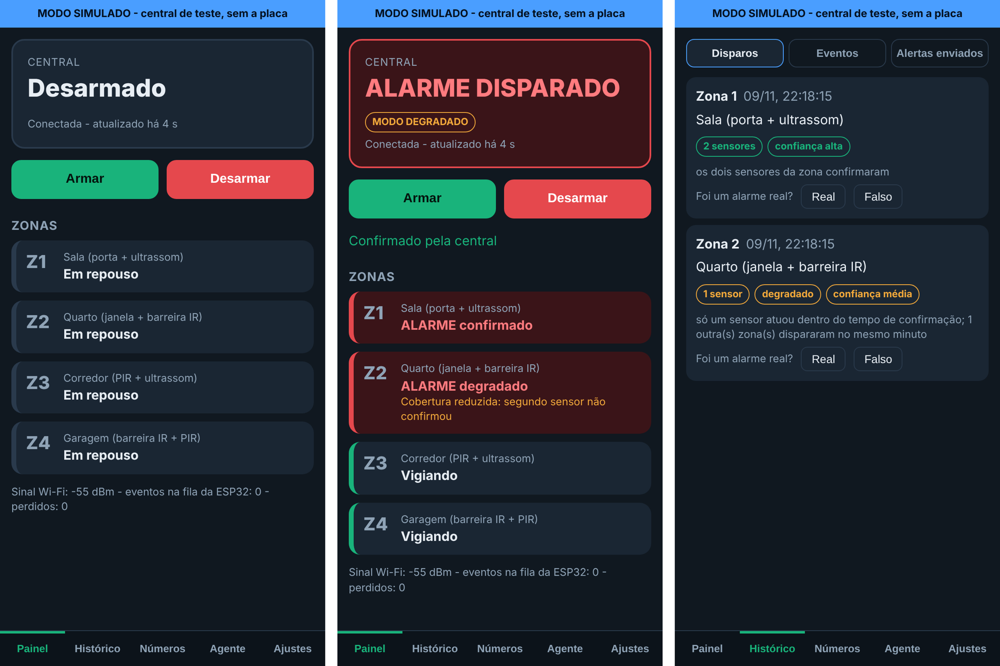
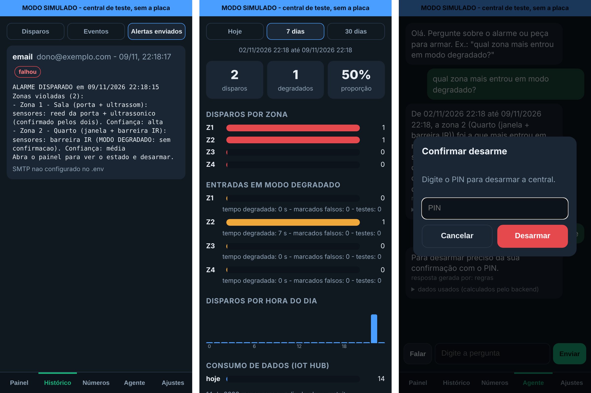

# 6. Nuvem, backend e aplicativo

## 6.1 Escolha da nuvem

Comparamos as opções do enunciado:

| Opção | Limite do plano gratuito | Por que não (ou por que sim) |
|---|---|---|
| Arduino Cloud Free | 2 Things, 5 variáveis, histórico de 1 dia | Sem API e sem gatilhos de alerta no plano gratuito |
| Adafruit IO Free | 10 feeds, 30 pontos por minuto, 30 dias | Funciona, mas os 10 feeds ficam todos ocupados e o comando não tem resposta síncrona |
| **Azure IoT Hub F1** | 8 000 mensagens por dia, 1 hub gratuito por assinatura | **Escolhido** |

Motivos da escolha do Azure IoT Hub:

- MQTT sobre TLS com autenticação por dispositivo (cada dispositivo tem a sua chave e pode ser revogado sozinho).
- **Direct method**: o comando tem resposta, que é exatamente o que o requisito de "resposta efetiva do FPGA" precisa.
- O plano F1 é gratuito e não consome o crédito de estudante. O resto do sistema (backend, banco, alertas e modelo de linguagem) roda fora do Azure ou em serviços gratuitos, então o custo do projeto na nuvem é zero.

**Limites registrados** (conferidos em 09/11/2026): 8 000 mensagens por dia, contadas em blocos de 0,5 kB, e um hub gratuito por assinatura. O nosso consumo: um status por minuto dá 1 440 mensagens por dia; cada disparo gera de 3 a 6 mensagens; cada comando, 2. O aplicativo mostra o consumo do dia contra o limite.

## 6.2 Backend

Em `backend/`, feito em Python com Flask. Arquivos principais:

| Arquivo | Função |
|---|---|
| `transporte.py` | Lê os eventos do IoT Hub (endpoint compatível com Event Hub) e envia comandos por direct method, com SAS token de serviço |
| `ingestao.py` | Grava eventos sem duplicar, atualiza incidentes e decide os alertas |
| `alertas.py` | E-mail, WhatsApp e Telegram |
| `estatisticas.py` | `consultar_eventos` e `calcular_estatisticas` |
| `ia.py` | Nota de falso-positivo |
| `agente.py` | Agente com chamada de funções |
| `simulador.py` | Central simulada, para desenvolver e testar sem a placa |
| `app.py` | API e servidor do aplicativo |

### Banco de dados

SQLite em um arquivo (`alarme.db`), sem servidor. Tabelas:

- `eventos`: uma linha por evento, com `event_id` único, `incident_id`, sequência, horário do evento e de recebimento, zona, tipo, estado, degradação, motivo, sensores que atuaram, falha e indicador TESTE.
- `incidentes`: uma linha por disparo de zona, atualizada pela confirmação ou pela degradação.
- `estado`: último estado conhecido e quando chegou.
- `comandos`: `cmd_id`, ação, origem (painel, voz ou agente), usuário, validade e resultado.
- `alertas`: o que foi enviado, para quem, por qual canal e se deu certo.
- `consumo`: mensagens e bytes por dia.

### Comando remoto

O backend autoriza (login; no desarme também o PIN), cria o `cmd_id`, define a validade de 15 s e chama o direct method. O resultado mostrado ao usuário é um destes: **confirmado**, **recusado**, **sem confirmação** (a central não respondeu no prazo) ou **comando vencido**. Enquanto espera, o painel mostra "operação pendente". Um pedido repetido com o mesmo `cmd_id` devolve o resultado guardado.

### Alertas

Quando a central entra em DISPARO, o backend espera 2,5 s (para a confirmação do segundo sensor chegar) e envia o alerta para todos os contatos ativos, por todos os canais que cada um cadastrou:

- **E-mail** por SMTP (Gmail com senha de app).
- **WhatsApp** pelo CallMeBot, serviço gratuito para uso pessoal.
- **Telegram** por bot (opcional).

O texto sempre lista as zonas violadas, com o nome do cômodo, os sensores que atuaram, se foi confirmado ou degradado e a confiança. Exemplo real, gerado no modo simulado:

```
ALARME DISPARADO em 09/11/2026 22:16:26
Zonas violadas (1):
- Zona 1 - Sala (porta + ultrassom): sensores: reed da porta + ultrassonico
  (confirmado pelos dois). Confiança: alta
Abra o painel para ver o estado e desarmar.
```

Se outra zona dispara com a central já em DISPARO, sai um segundo alerta com a nova zona. Zona degradada, falha de sensor e isolamento geram um aviso de manutenção por e-mail. Disparos em modo TESTE saem marcados com [TESTE].

## 6.3 Redução de falso-positivo

Está em três níveis:

1. **No FPGA**: sincronização, debounce e persistência em cada sensor (o ultrassônico precisa de 3 medidas seguidas fora da faixa), e a confirmação por dois sensores de tipos diferentes.
2. **No arme**: a central recusa armar com sensor ativo, o que evita o disparo imediato por porta esquecida aberta.
3. **No backend**: cada incidente recebe uma probabilidade de ser falso. No início ela vem de regras (confirmado pelos dois sensores, degradado, falha diagnosticada, outras zonas no mesmo minuto, histórico da zona). O usuário marca no aplicativo se cada disparo foi real ou falso. Com 20 marcações ou mais, uma regressão logística (scikit-learn) é treinada com essas mesmas características e a nota passa a ser a média entre as regras e o modelo.

A nota não bloqueia nada. A sirene e as contramedidas são decididas só pelo FPGA. A nota entra no texto do alerta como confiança alta, média ou baixa, e nas estatísticas.

## 6.4 Agente e limites do modelo de linguagem

O agente recebe texto. A voz é transcrita no celular (Web Speech API) e chega na mesma rota autenticada, então texto e voz usam as mesmas funções e as mesmas regras.

Funções disponíveis para o modelo: `estado_atual`, `consultar_eventos`, `calcular_estatisticas`, `solicitar_arme` e `solicitar_desarme`.

O que limita o modelo:

- **Ele não calcula**. Contagens, proporção de disparos degradados e tempo de falha são calculados em `estatisticas.py`. O aplicativo mostra, junto da resposta, os dados que o backend calculou, para dar para conferir.
- **Ele não desarma**. `solicitar_desarme` só devolve "ação pendente". O aplicativo pede o PIN e manda o desarme pelo mesmo caminho do painel.
- **Ele não confirma nada**. O arme pedido pelo agente passa pela mesma função do painel, e a resposta que ele dá ao usuário é o resultado que veio da central.
- **Ele pode faltar**. O modelo roda local no Ollama. Se não estiver disponível, o agente cai em um interpretador por palavras-chave que chama as mesmas funções. A resposta informa qual dos dois gerou o texto.

Exemplo de resposta (modo por regras, dados do simulador): "De 02/11/2026 22:16 até 09/11/2026 22:16, a zona 2 (Quarto) foi a que mais entrou em modo degradado: 1 vez. No período, 1 de 2 disparos foram degradados. Recomendo verificar cabo, alinhamento e resposta do sensor dessa zona."

## 6.5 Aplicativo

PWA em React (`app/`), servido pelo próprio backend. Abre no navegador do PC e do celular e pode ser instalado na tela inicial.

| Tela | O que mostra |
|---|---|
| Painel | Estado da central, selos de MODO DEGRADADO e TESTE, conexão e idade do dado, botões de armar e desarmar, as quatro zonas |
| Histórico | Disparos (com confiança e botões Real/Falso), eventos e alertas enviados |
| Números | Disparos por zona, entradas em modo degradado, tempo degradada, disparos por hora, recomendações e consumo de mensagens |
| Agente | Conversa por texto ou voz |
| Ajustes | Contatos dos alertas, alerta de teste e, no modo simulado, os sensores da central simulada |

O painel diferencia dado recente de dado antigo: se o último status tem mais de 150 s, o cartão da central fica tracejado e apagado e aparece "SEM CONEXÃO, último estado conhecido de ...", com o aviso de que o alarme local continua funcionando.

{width=16cm}

{width=16cm}

As telas acima foram capturadas com o backend no modo simulado.
