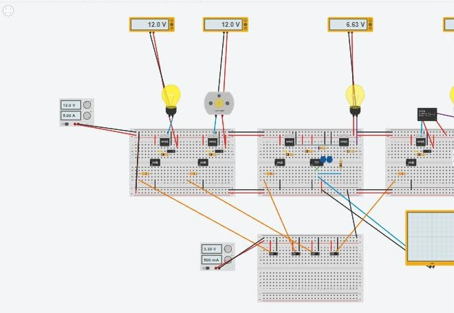
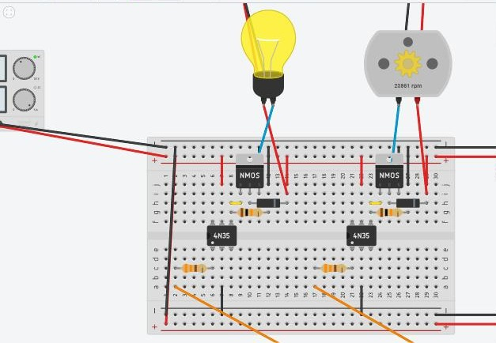
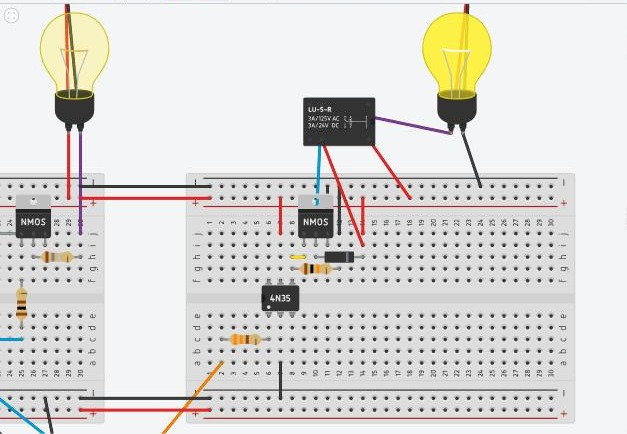
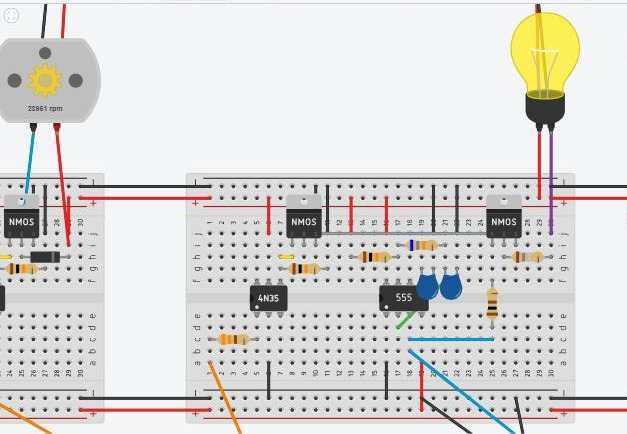
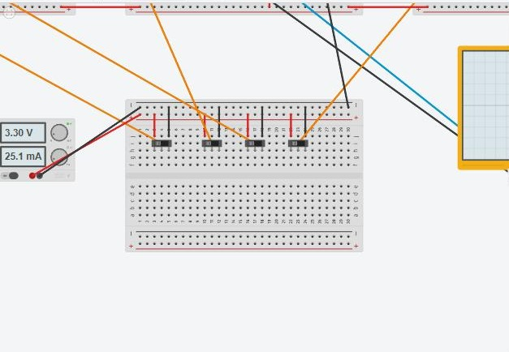

# Placa de potência: montagem copiada do Tinkercad

Circuito no Tinkercad: **Potencia_Alarme_10401198**
(https://www.tinkercad.com/things/iQ5IsF13NpE/editel)

São 4 canais iguais, um para cada saída da FPGA. A FPGA liga um optoacoplador, o opto liga um MOSFET e o MOSFET liga a carga de 12 V. A FPGA (3,3 V) nunca encosta no 12 V.

| Canal | Saída FPGA (XDC) | Pino Basys 3 | Carga real | No Tinkercad |
|---|---|---|---|---|
| 1 | `sirene` | JB3 (B15) | sirene 12 V | lâmpada L1 |
| 2 | `estrobo` | JB4 (B16) | LED de potência piscando (555) | lâmpada L2 |
| 3 | `nevoa` | JB7 (A15) | bomba da névoa | motor M1 |
| 4 | `cerca` | JB8 (A17) | relé K1 → carga da cerca | relé + lâmpada L3 |

No Tinkercad as chaves S1–S4 e a fonte P2 de 3,3 V fazem o papel da FPGA. Na montagem real, cada fio laranja vai num pino do Pmod JB e o GND da Basys 3 vai no trilho − da placa de potência. **Sem esse GND comum o circuito não funciona.**

## Como ler as posições

- Protoboard pequena: colunas 1 a 30 e linhas a–j. As linhas a–e ficam na metade de baixo e f–j na de cima, com o vão no meio.
- Furos na mesma coluna e na mesma metade estão ligados entre si (ex.: a7, b7, c7, d7 e e7).
- "+ cima" e "− cima" são os trilhos de cima, e "+ baixo" e "− baixo" os de baixo.
- Todos os + são 12 V e todos os − são GND (menos na placa da FPGA, onde o + é 3,3 V).
- Cores dos fios: vermelho = +, preto = GND, amarelo = gate, laranja = sinal da FPGA.

## Alimentação (fazer primeiro)

1. Fonte 12 V: + no **PLACA1 + cima col 1** e − no **PLACA1 − cima col 1**.
2. Na PLACA1, ligar os trilhos de cima aos de baixo: + cima col 2 → + baixo col 1 e − cima col 2 → − baixo col 1.
3. Emendar as placas pela coluna 30 → coluna 1, nos 4 trilhos:
   - PLACA1 → PLACA2;
   - PLACA2 → PLACA3.
4. GND da FPGA (ou da placa das chaves): − cima col 30 → **PLACA2 − baixo col 27**.

## Canal padrão (usado nos canais 1, 3 e 4)

Abaixo está o canal 1 da PLACA1. O canal 3 é igual, só que **15 colunas para a direita**, e o canal 4 é idêntico ao 1 só que na PLACA3.

| Peça | Furos |
|---|---|
| R 330 Ω (entrada do LED do opto) | c2 – c6 |
| 4N35 (U1), atravessando o vão | Anode e6, Cathode e7, NC e8, Base f6, Collector f7, Emitter f8 |
| R 10 kΩ (pull-down do gate) | g8 – g12 |
| MOSFET IRF540N (T1), face para baixo | Gate i9, Drain i10, Source i11 |
| Diodo 1N4007 (D1), **listra no h14** | ânodo h10, cátodo h14 |

| Fio | De → Para |
|---|---|
| preto | a7 → − baixo (cátodo do LED do opto) |
| vermelho | j7 → + cima (coletor no 12 V) |
| amarelo | h8 → h9 (emissor → gate) |
| preto | j12 → − cima (fim do 10 kΩ) |
| preto | j11 → − cima (source) |
| vermelho | j14 → + cima (cátodo do diodo) |
| laranja | sinal da FPGA → a2 |
| carga + | i14 |
| carga − | j10 (drain) |

O diodo fica em paralelo com a carga, virado ao contrário. Ele protege o MOSFET do pico de tensão da sirene, da bomba e da bobina do relé. Se ele for colocado invertido, vira um curto no 12 V.

### Canal 1 – sirene (PLACA1, colunas 2–14)
Tabela acima. Sinal: chave/FPGA `sirene` → **PLACA1 a2**. Sirene: + em i14, − em j10.

### Canal 3 – névoa (PLACA1, colunas 17–29)
- R 330 Ω c17–c21. 4N35 nas colunas 21–23: Anode e21, Cathode e22, Base f21, Collector f22, Emitter f23.
- R 10 kΩ g23–g27. MOSFET: G i24, D i25, S i26. Diodo h25–h29, listra no h29.
- Fios:
  - pretos a22 → − baixo, j27 → − cima e j26 → − cima;
  - vermelhos j22 → + cima e j29 → + cima;
  - amarelo h23 → h24.
- Sinal `nevoa` → **PLACA1 a17**. Bomba: + em i29, − em j25. Se a bomba girar ao contrário, inverta os dois fios dela.

### Canal 4 – cerca (PLACA3, colunas 2–14)
- Igual ao canal 1, na PLACA3. Sinal `cerca` → **PLACA3 a2**.
- A carga desse canal é a **bobina do relé**: COIL1 em i14 e COIL2 em j10.
- Contatos do relé:
  - COM → + cima col 18;
  - NA (NO) → carga da cerca (+);
  - carga (−) → − cima col 24.

## Canal 2 – estrobo (PLACA2)

O 555 fica oscilando o tempo todo (~10 Hz). Quem decide se o LED acende é o MOSFET T2, ligado pelo opto, que fica **em série** com o MOSFET T5 do 555. Fizemos assim porque usar o pino Reset do 555 não desligava direito: ele ficava em ~2,4 V com pull-down de 10 kΩ.

**Parte do opto (colunas 1–11)**
- R 330 Ω c1–c5. 4N35: Anode e5, Cathode e6, Base f5, Collector f6, Emitter f7.
- R 10 kΩ g7–g11. MOSFET T2: G i8, D i9, S i10.
- Fios:
  - pretos a6 → − baixo, j11 → − cima e j10 → − cima;
  - vermelho j6 → + cima;
  - amarelo h7 → h8.
- Sinal `estrobo` → **PLACA2 a1**.

**Oscilador 555 (colunas 13–22)**
- 555 (U5) atravessando o vão, com o pino 1 (GND) em e16:

  | Pino | Furo | Pino | Furo |
  |---|---|---|---|
  | GND | e16 | Vcc | f16 |
  | TRIG | e17 | DIS | f17 |
  | OUT | e18 | THR | f18 |
  | RESET | e19 | CTRL | f19 |

- R5 10 kΩ h13–h17 e R6 68 kΩ i17–i21.
- C1 1 µF g21–g22. Se for eletrolítico, o **+ vai no g21** e o − no g22.
- C2 10 nF g19–g20.
- Fios:
  - vermelhos j13 → + cima, j16 → + cima e a19 → + baixo (RESET sempre em 12 V);
  - pretos a16 → − baixo, j20 → − cima e j22 → − cima;
  - verde j21 → j18 (THR no capacitor);
  - verde d17 → f21 (TRIG no capacitor).
- Frequência: f = 1,44 / ((R5 + 2·R6)·C1) = 1,44 / ((10k + 136k)·1µ) ≈ **9,9 Hz**.

**Saída (colunas 25–30)**
- Azul c18 → c25 (OUT do 555). R7 100 Ω em pé de d25 a f25.
- MOSFET T5: G i25, D i26, S i27. Cinza j27 → j9 (source do T5 no drain do T2).
- R8 1,8 Ω h26–h30. LED/lâmpada: + no + cima col 29, − no j30.

## Placa da FPGA (só no Tinkercad)

Fonte P2 de 3,3 V nos trilhos de cima. Cada chave deslizante tem a perna 1 no +, a 2 no − e o meio (comum) indo para o fio laranja:

| Chave | Pernas | Fio laranja vai para |
|---|---|---|
| S1 sirene | h3 / h4 / h5 | PLACA1 a2 |
| S2 estrobo | h10 / h11 / h12 | PLACA2 a1 |
| S3 névoa | h16 / h17 / h18 | PLACA1 a17 |
| S4 cerca | h22 / h23 / h24 | PLACA3 a2 |

Na montagem real essa placa sai e entram os fios do Pmod JB (JB3, JB4, JB7, JB8) mais o GND da Basys 3.

## Resultado da simulação

| Chaves | Sirene | Estrobo | Névoa | Cerca |
|---|---|---|---|---|
| todas ligadas | 12,0 V | pisca (~10 Hz) | 12,0 V (motor girando) | 12,0 V |
| todas desligadas | 0 V | 0 V | 0 V | 0 V |

Cada canal liga e desliga sozinho, sem interferir nos outros.

## Diferenças entre o Tinkercad e as peças reais

- **4N35 × PC817**: o Tinkercad não tem PC817, mas a função é a mesma. Pinagem do PC817 (4 pinos): 1 = ânodo, 2 = cátodo, 3 = emissor, 4 = coletor. O pino Base do 4N35 fica sem ligar.
- **Cargas**:
  - as lâmpadas representam a sirene e o LED de potência;
  - o motor representa a bomba.
- **LED de 5 W ou 10 W**: o enunciado pede 10 W. Se o de vocês for de 5 W, vale conferir ou trocar. O R8 de 1,8 Ω é para LED de 10 W em 12 V (≈ 0,8 A). Com LED de 5 W, use ~3,3 Ω. Se for módulo com driver próprio, tire o R8 e ligue direto.
- **MOSFET**: o IRF540N funciona porque o gate recebe ~11 V do opto, e não os 3,3 V da FPGA.
